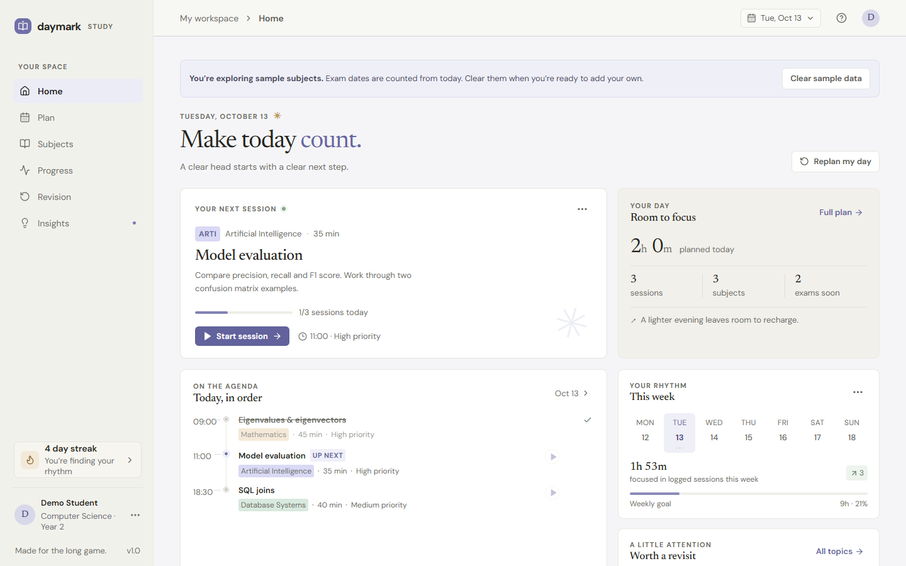
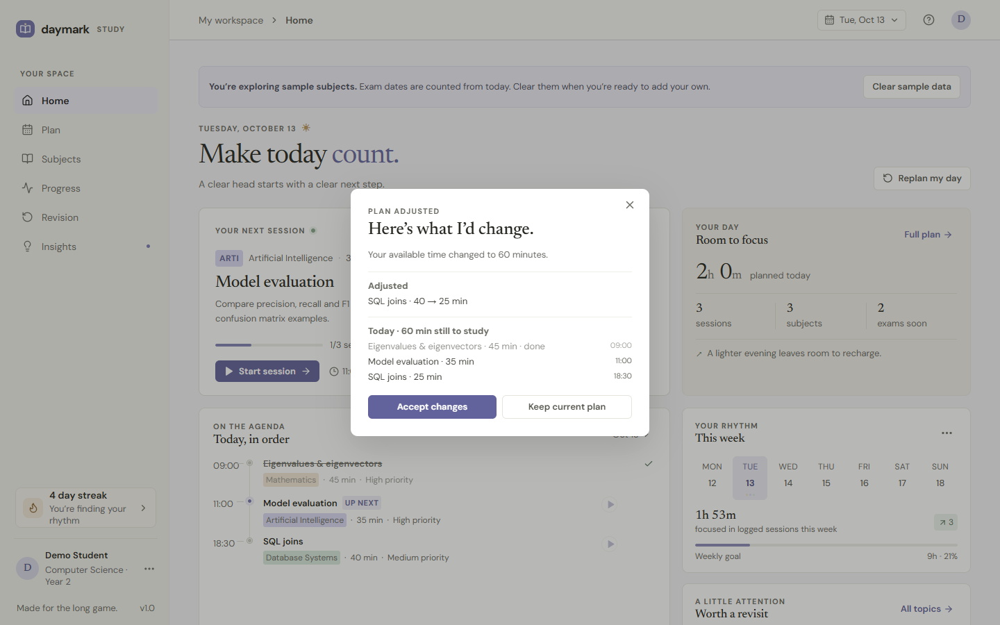
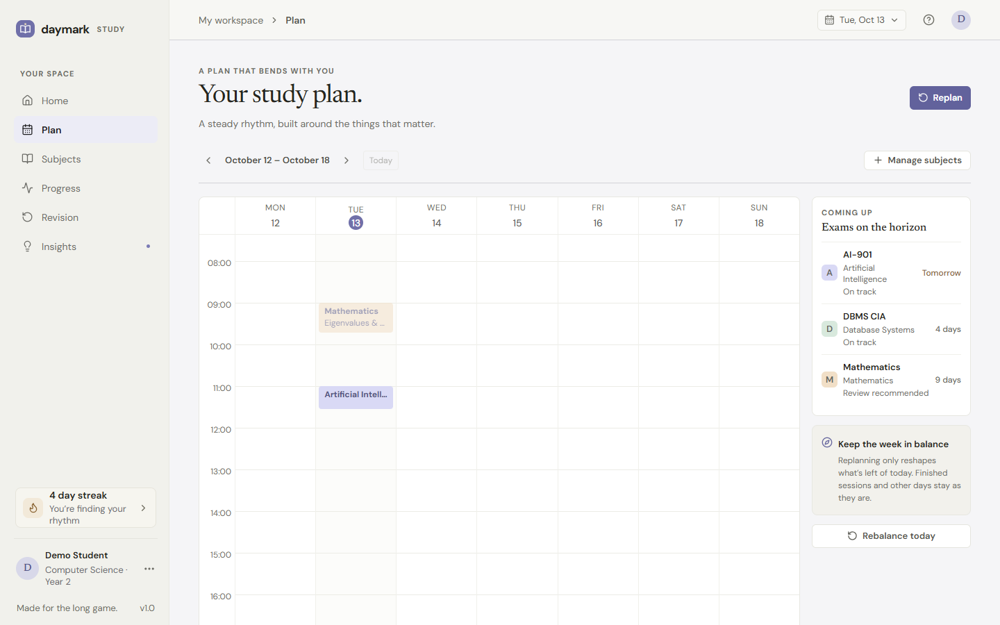
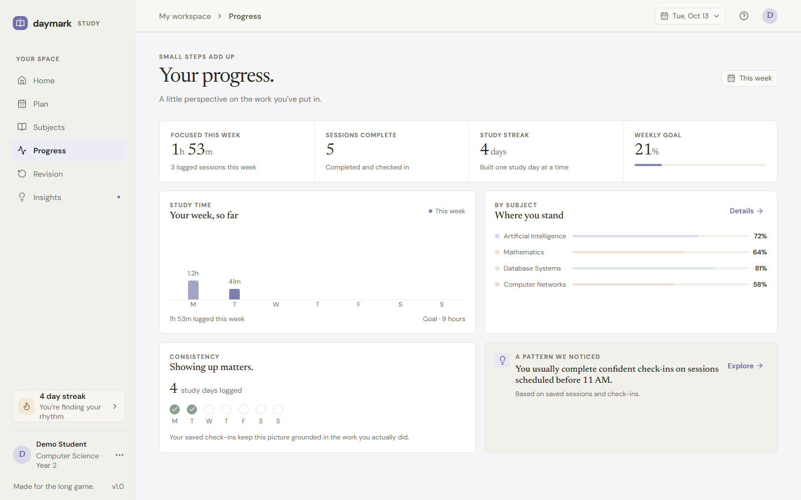
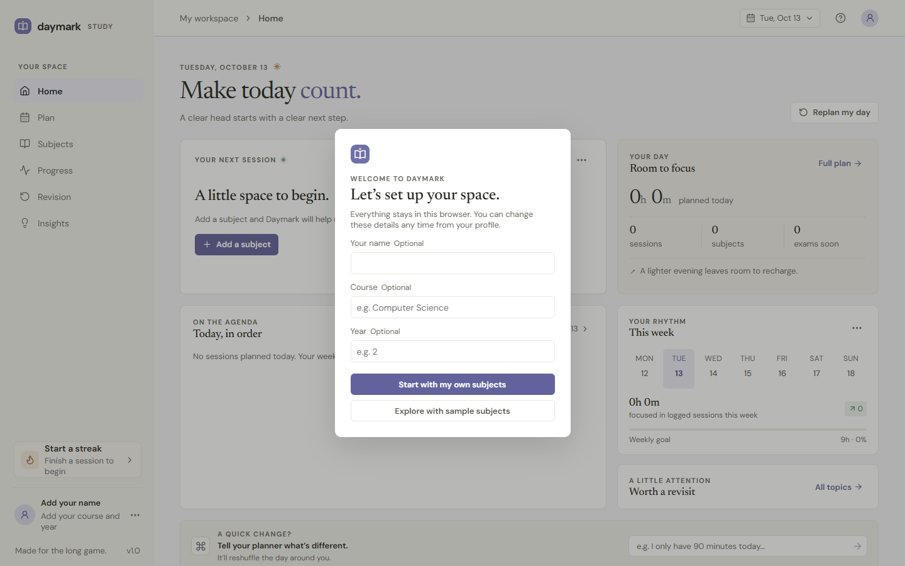
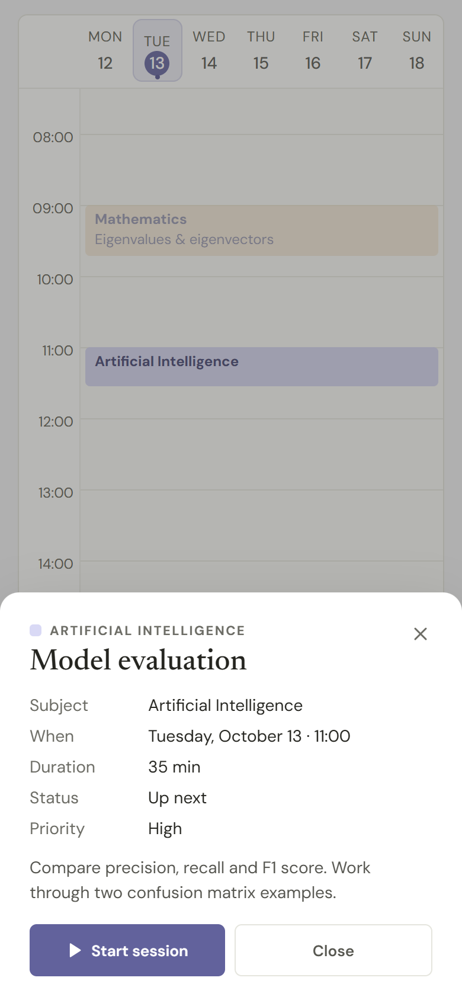
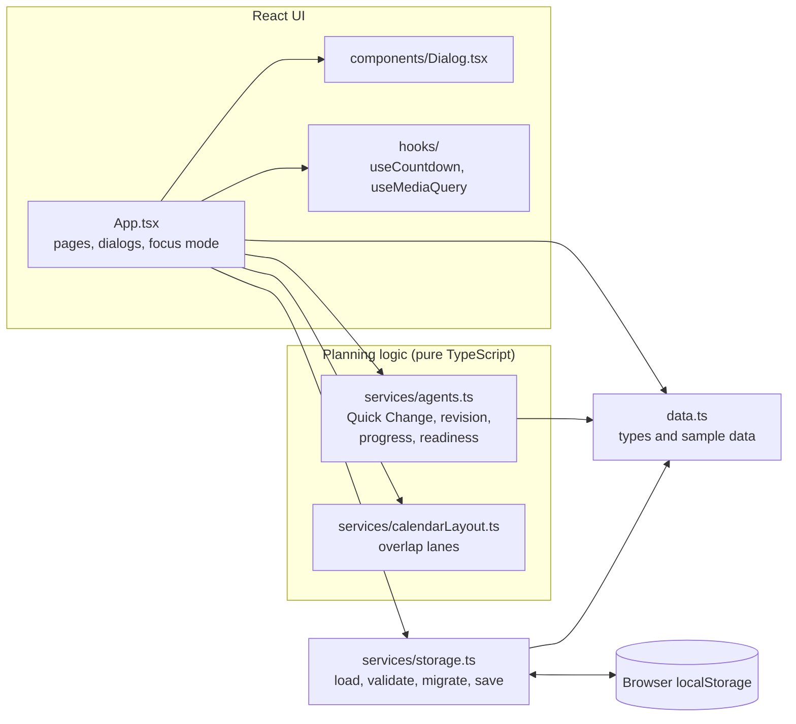

<div align="center">

<samp><b>DAYMARK · PERSONALISED STUDY PLANNER</b></samp>

<samp>react · typescript · vite · adaptive planning · local-first</samp>

</div>

---

<div align="center"><samp>Daymark reshapes your study day around what actually happens: less time than expected, an exam tomorrow, a missed session or a topic that didn't stick. It runs in the browser and keeps your data on your device.</samp></div>

<div align="center">

**[Open Live App](https://personalised-study-planner.vercel.app/)** · [Source Code](https://github.com/yo5on/Personalised-study-planner)

</div>



_All screenshots show the real app running with its built-in sample subjects and a demo profile. No real study data is shown. Dates in the screenshots are from the day they were taken. In the app, sample exam dates are always counted from the day you load the samples._

## Why Daymark

Most study timetables are fixed: once a day goes off-plan, the timetable stops being useful. Daymark treats the plan as something that bends. You tell it what changed in plain language, review exactly what it proposes, and accept or decline. Each completed session ends with a short confidence check-in, and those check-ins drive what comes up for revision.

## Features

- **Daily and weekly planning.** A dashboard with the next session and today's agenda, plus a weekly calendar with exam countdowns and readiness labels.
- **Quick Change.** Plain-language requests such as "I only have 60 minutes today", "my DBMS exam is tomorrow", "focus on Mathematics", "I'm too tired" or "I finished SQL joins". Every change is shown for review before it's applied, and requests Daymark can't act on are reported as such.
- **Missed sessions.** Marking a session missed moves it to the next free slot today without overlapping anything, or to tomorrow if today is full.
- **Focus timer.** Start, pause, resume and reset, a time's-up notice, and a confirmation before you abandon a session in progress.
- **Confidence check-ins.** Each session ends with a 1–5 confidence rating and an outcome. Ratings update the subject's estimated mastery.
- **Revision.** Topics whose most recent check-in was low confidence are queued for review. A later confident check-in clears them.
- **Progress and insights.** Weekly study time, streak, consistency and a weekly goal, plus observations generated from your saved check-ins.
- **Responsive calendar.** Overlapping sessions sit side by side. On phones the calendar shows one day at a time, and tapping a session opens its full details instead of starting it.
- **Onboarding and sample data.** New users start from a blank plan or optional sample subjects whose exam dates are counted from today. Sample data can be cleared in one step.

## How the planning works

Daymark's planning is **rule-based TypeScript, not a language model**. There is no AI service, API key or network call behind Quick Change. Requests are matched against a defined set of patterns (available time, exams, focus, finished topics, tiredness, missed sessions and rebalancing), and plans are adjusted by pure functions in [`src/services/agents.ts`](src/services/agents.ts). As a result, the behaviour is predictable, works offline and is covered by unit tests. The trade-off is that requests outside those patterns aren't understood, and the app says so rather than guessing.

## Screenshots

| Quick Change review                                                                                                | Weekly planner                                                                            |
| ------------------------------------------------------------------------------------------------------------------ | ----------------------------------------------------------------------------------------- |
|         |  |
| **Progress**                                                                                                       | **Welcome step**                                                                          |
|  |     |

<p align="center">
  
  <br>
  <em>On a phone, tapping a calendar session opens its details instead of starting it.</em>
</p>

## Tech stack

- **React 18** and **TypeScript** (strict mode), built with **Vite 6**
- **lucide-react** for icons
- **Vitest**, **React Testing Library** and **jsdom** for tests
- **ESLint** (typescript-eslint, react-hooks) and **Prettier**
- Browser **localStorage** for persistence. There is no backend.

## Architecture

The UI and the planning logic are kept apart. React components hold UI state only; every planning decision lives in plain, testable functions.



Engineering decisions worth noting:

- **Validated persistence.** Saved state is checked field by field on load. Malformed entries, duplicate IDs and bad dates are dropped rather than crashing the app, and unreadable data is backed up before it could be overwritten.
- **Deadline-based timer.** The focus timer counts against a fixed end time instead of counting ticks, so it stays accurate when the browser throttles background tabs.
- **Non-destructive plan changes.** Quick Change only reshapes the remaining sessions for today. Finished sessions and other days are never altered, and nothing is applied until you accept.
- **Accessibility.** Dialogs trap focus, close with Escape and return focus to whatever opened them. There's a skip link and every control has an accessible name. Text colours were tuned to WCAG AA contrast (4.5:1) on the app's light surfaces. On touch screens, controls have targets of at least 44px, except the phone calendar's day picker, where seven days must fit across the screen (40px).

## Getting started

### Requirements

- **Node.js 22.22+ or 24.15+.** The test tooling (Vitest and jsdom) requires one of these. The app itself builds on older versions, but use one of these for the full workflow.
- **npm** (bundled with Node.js)

The commands are the same in Windows PowerShell, Command Prompt, Git Bash, macOS and Linux terminals.

```bash
git clone https://github.com/yo5on/Personalised-study-planner.git
cd Personalised-study-planner
npm install
npm run dev
```

Then open the local URL Vite prints (usually `http://localhost:5173`).

### Environment variables

None. Daymark has no backend, API keys or environment configuration.

### Scripts

| Command                | What it does                                           |
| ---------------------- | ------------------------------------------------------ |
| `npm run dev`          | Start the Vite development server                      |
| `npm run build`        | Typecheck, then build a production bundle into `dist/` |
| `npm run preview`      | Serve the production build locally                     |
| `npm run lint`         | Run ESLint                                             |
| `npm run typecheck`    | Run the TypeScript compiler without emitting files     |
| `npm test`             | Run all tests once with Vitest                         |
| `npm run format`       | Format the project with Prettier                       |
| `npm run format:check` | Check formatting without changing files                |

## Testing

`npm test` runs 60 tests in 4 files:

- **Planning logic** (`src/services/agents.test.ts`): Quick Change parsing and plan adaptation, missed-session rescheduling, revision, streaks and weekly progress.
- **Persistence** (`src/services/storage.test.ts`): validation of malformed data, the backup of unreadable data, migration from older versions and existing-user handling.
- **Calendar layout** (`src/services/calendarLayout.test.ts`): placing overlapping sessions side by side.
- **Components** (`src/App.test.tsx`, React Testing Library): onboarding, navigation, Quick Change accept/decline/unrecognised, dialog dismissal and focus return, the timer (pause, resume, time's up and check-in), revision check-ins, and the phone calendar's tap-for-details behaviour.

What the tests don't cover:

- There are no end-to-end browser tests in the repository. Responsive layouts were checked by hand in a browser at phone, tablet and desktop widths.
- No screen-reader testing (NVDA, VoiceOver, TalkBack) has been done.

**Continuous integration:** GitHub Actions ([`.github/workflows/ci.yml`](.github/workflows/ci.yml)) runs the formatting check, lint, typecheck, tests and production build on Node.js 22 and 24 for every push to `main` and every pull request.

## Data and privacy

- All data (profile, subjects, sessions, check-ins and plan changes) is stored in your browser's `localStorage` under the key `daymark-state`. Nothing is sent to a server, and there are no accounts or analytics.
- If saved data can't be read, a copy is kept under `daymark-state-unreadable-backup` before the app starts fresh.
- Data stays on one browser and device. It doesn't sync, and clearing site data or using a private window removes it.
- The page loads its fonts (DM Sans and Newsreader) from Google Fonts, so your browser requests those files from Google.

## Known limitations

- Quick Change understands a fixed set of request patterns. It isn't a general language model.
- Data is stored only in the browser. There's no export, import or cross-device sync.
- Estimated mastery is a simple weighted average of confidence check-ins, not an assessment.
- The weekly goal is fixed at 9 hours.
- Only English is supported.

## Possible next steps

- Export and import of study data as a file
- An optional synced backend for use across devices
- End-to-end browser tests, run in CI
- A configurable weekly goal and study hours

## Project structure

```text
src/
├── App.tsx                  # Pages, dialogs and focus mode
├── App.test.tsx             # Component tests (React Testing Library)
├── main.tsx                 # Entry point
├── data.ts                  # Types and optional sample data
├── styles.css               # Styling
├── components/
│   ├── DaymarkMark.tsx      # Logo
│   └── Dialog.tsx           # Accessible modal wrapper
├── hooks/
│   ├── useCountdown.ts      # Deadline-based focus timer
│   └── useMediaQuery.ts     # Responsive and touch behaviour
└── services/
    ├── agents.ts            # Rule-based planning, revision and progress logic
    ├── calendarLayout.ts    # Places overlapping calendar sessions
    └── storage.ts           # Loading, validation, migration and saving
docs/screenshots/            # README screenshots of the running app
.github/workflows/ci.yml     # GitHub Actions: format, lint, typecheck, test, build
```

## Author

<div align="center">

---

<samp><strong>Yoson</strong> · software, AI/ML and learning tools</samp>

<samp><a href="https://github.com/yo5on">github.com/yo5on</a> · <a href="https://www.linkedin.com/in/yo5on">LinkedIn</a></samp>

</div>
